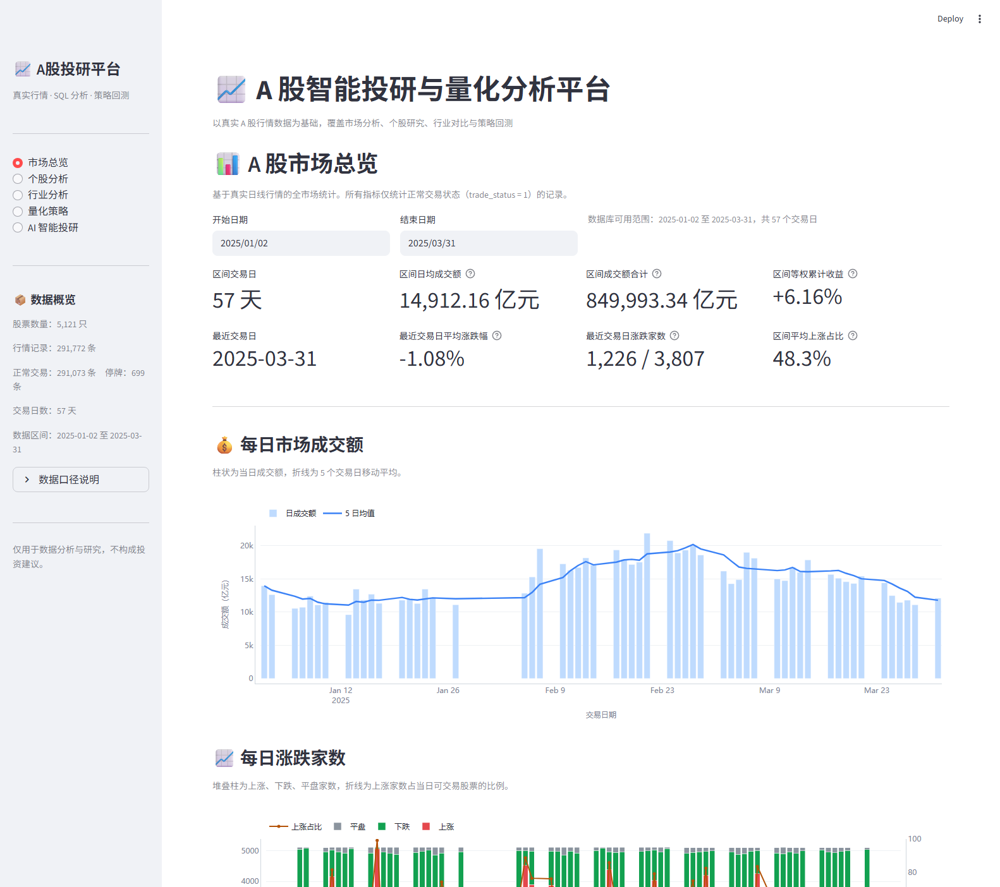
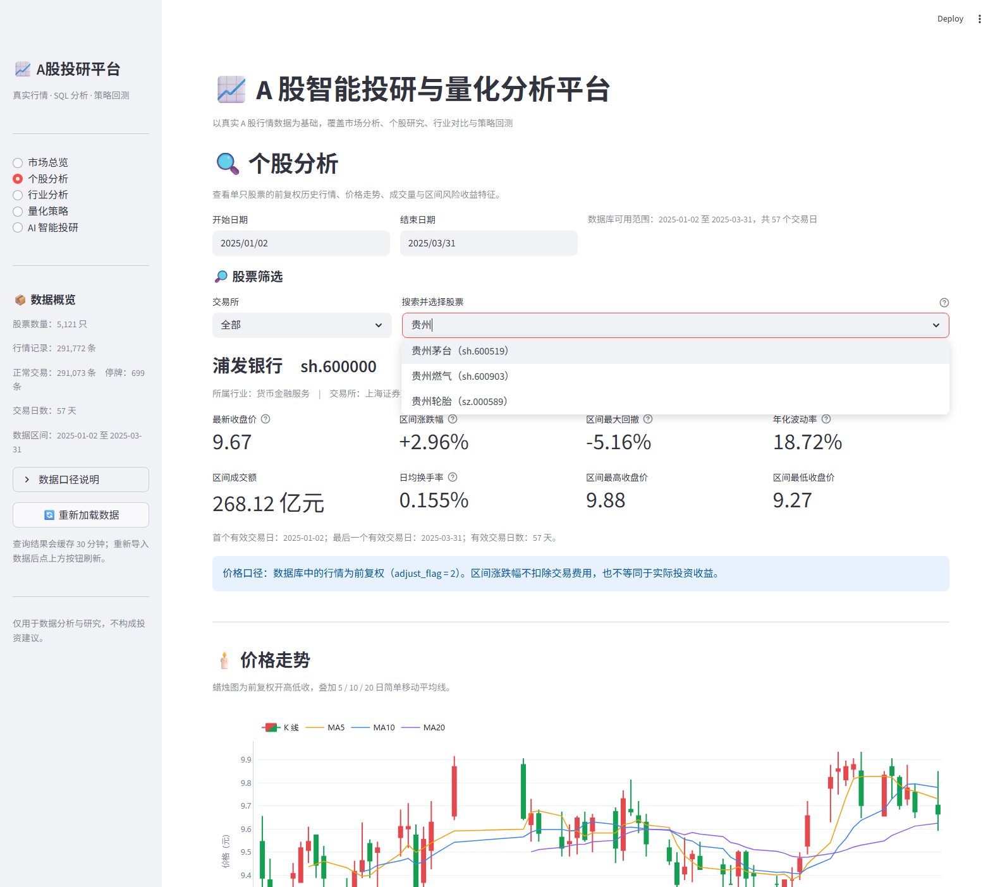
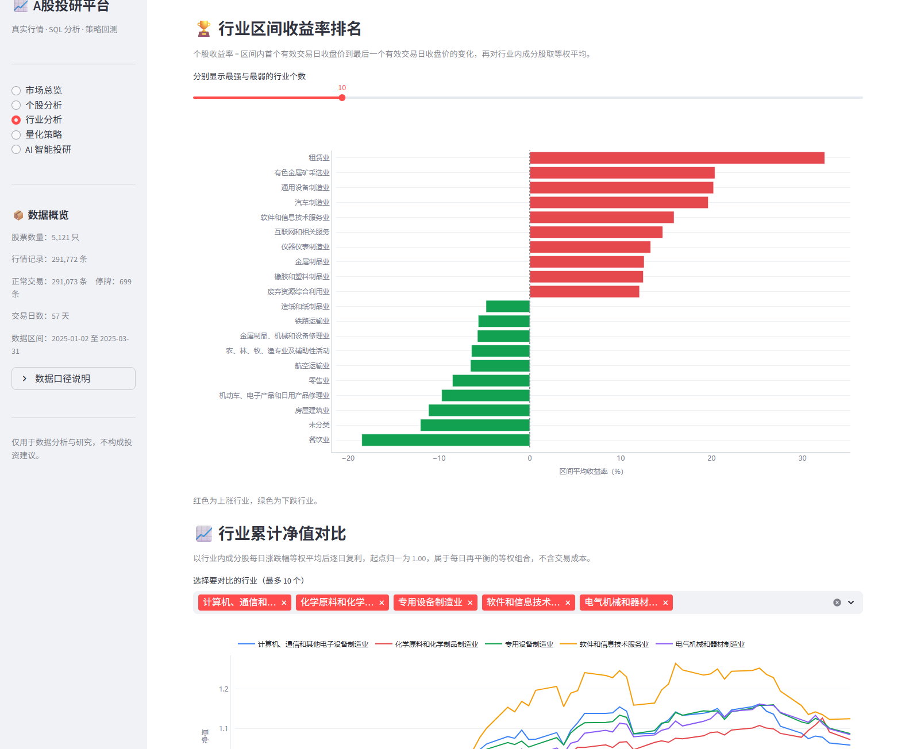

# A股智能投研与量化分析平台

基于真实 A 股行情数据的投研看板，覆盖市场总览、个股研究、行业对比与策略回测。

在线演示：<https://a-share-quant.streamlit.app>

## 功能

| 页面 | 内容 |
| --- | --- |
| 市场总览 | 成交额、涨跌家数、上涨占比、市场宽度、日均涨跌幅 |
| 个股分析 | K 线、成交量、区间收益、波动率与最大回撤 |
| 行业分析 | 行业区间收益排名、行业净值曲线、成分股统计 |
| 量化策略 | 横截面动量轮动、双均线择时，含交易成本与基准对比 |
| AI 智能投研 | 投研流程设计说明（尚未接入模型） |

## 界面预览

### 市场总览

区间成交额与 5 日移动平均、涨跌家数堆叠柱、上涨占比副轴。



### 个股分析

支持关键字搜索的股票选择器，K 线与 5/10/20 日均线。



### 行业分析

行业区间收益率排名与累计净值对比。



## 技术栈

Streamlit、pandas、Plotly、SQLAlchemy。

## 数据

- 来源：BaoStock 日线行情。
- 规模：5,121 只股票、291,772 条记录、57 个交易日（2025-01-02 至 2025-03-31）。
- 复权方式：前复权（`adjust_flag = 2`）。
- 交易状态：仅 `trade_status = '1'` 的记录计入涨跌、成交额与收益统计。
- 行业分类：证监会行业门类，取自 `stock_info`，为当前时点分类。
- 基准定义：全市场等权、每日再平衡，不含交易成本，不等同于任何公开指数。

## 目录结构

```text
app.py                      入口：页面配置、侧边栏、路由
requirements.txt            依赖清单
.streamlit/config.toml      运行配置
src/
  build_sqlite.py           从源 CSV 生成 SQLite 数据文件与压缩包
  get_stock_universe.py     采集股票池
  download_market_daily.py  下载全市场日线行情
  get_stock_info.py         采集股票基础信息
  import_stock_data.py      导入行情到 MySQL
  import_stock_info.py      导入基础信息到 MySQL
  dashboard/
    db.py                   数据访问与查询缓存
    ui.py                   图表主题与通用组件
    backtest.py             回测引擎（纯函数，不依赖 Streamlit）
    pages/                  五个功能页面
sql/                        建库脚本与数据分析 SQL
data/                       数据文件，仅 market.db.gz 纳入版本管理
```

## 数据后端

`src/dashboard/db.py` 按以下优先级自动选择后端，无需改动代码：

1. 环境变量 `DB_BACKEND`（`sqlite` 或 `mysql`）
2. 环境变量 `DATABASE_URL`
3. `DB_HOST` 与 `DB_USER` 同时存在时使用 MySQL
4. 以上均未配置时使用 SQLite

因此本地存在 `.env` 时连接 MySQL，云端无 `.env` 时自动使用 SQLite。

## 本地运行

### 方式一：SQLite（无需数据库服务）

```bash
pip install -r requirements.txt
python src/build_sqlite.py
streamlit run app.py
```

### 方式二：MySQL

```bash
pip install -r requirements.txt
mysql -u root -p < sql/建库和表.sql
python src/import_stock_info.py
python src/import_stock_data.py
```

将 `.env.example` 复制为 `.env` 并填写连接信息后运行 `streamlit run app.py`。

## 部署

部署于 Streamlit Community Cloud，入口文件为 `app.py`，Python 版本 3.12。

仓库内含 `data/market.db.gz`（约 22 MB）。应用启动时若不存在 `data/market.db`，会自动解压该文件后再连接，因此无需在平台上配置数据库或密钥。

## 数据更新

```bash
python src/build_sqlite.py
git add data/market.db.gz
git commit -m "data: 更新行情数据"
git push
```

`build_sqlite.py` 会重新生成 `data/market.db` 与 `data/market.db.gz`，推送后云端自动重新部署。

## 免责声明

本项目仅用于数据分析与研究，不构成任何投资建议。行情数据版权归原始数据源所有，本项目仅作研究与技术演示用途。

## 许可证

代码以 [MIT License](LICENSE) 发布。
